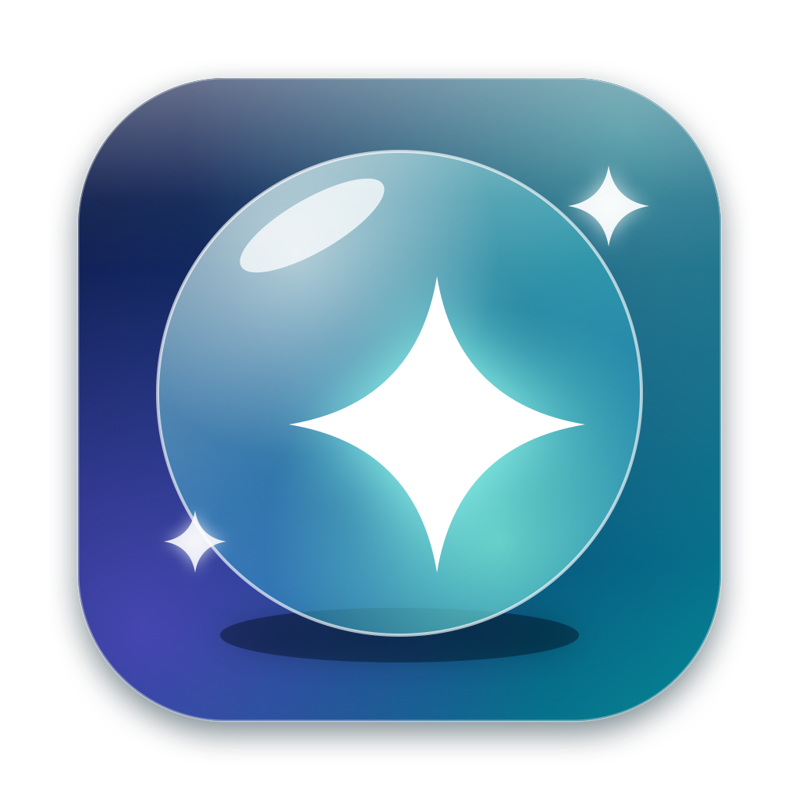

**English · [Français](README.fr.md)**

# Besom

**Sweep your Mac clean.**

Temp files, caches, logs, orphaned app data, old installers, the Trash: Besom finds what can go, shows you exactly what it is, and removes it in one click.

## Features

### 🧹 What it finds

| Family | What | Removal |
|---|---|---|
| **App caches** | `~/Library/Caches` (Apple's and running apps' are left alone) | Deleted |
| **Logs & crash reports** | `~/Library/Logs`, diagnostic reports | Deleted |
| **Temporary files** | your temp folder, untouched for 3+ days | Deleted |
| **Developer leftovers** | Xcode DerivedData and DeviceSupport, simulator caches, npm cache | Deleted |
| **Orphaned app data** | support files, preferences, saved state and launch agents left behind by uninstalled apps | **Trash** |
| **Old installers** | DMG / PKG / ISO in Downloads (14+ days), unfinished downloads | **Trash** |
| **Old device backups** | iPhone and iPad backups | **Trash** |
| **Trash** | everything in the Trash | Emptied for good |

### 🛡️ Built to be safe
- **Nothing is removed without your confirmation.** The dialog says how much is deleted for good and how much goes to the Trash.
- **Only regenerable data is ticked by default** (caches, logs, temp, developer caches). Orphans, installers, backups and the Trash are always your call.
- **Anything that isn't regenerable goes through the Trash first**, so you can still get it back.
- **Every item is inspectable**: untick it, or reveal it in Finder, before cleaning.
- **A guard re-checks each path right before removal.** It must sit strictly inside the allowed folders of its family. Symbolic links are resolved, so a link can't lead outside.
- **Orphan detection is conservative.** Anything modified in the last 30 days, Apple's own data, and anything matching an installed app, a running app, a Homebrew tool or a system binary is left alone.
- **Dry run from the terminal**: `Besom --scan` prints what would be cleaned and exits, deleting nothing.

### And also
- **Settings tab**: glass transparency and style, theme and background color, cleaning rules (ages, minimum size), families to scan, folders to never touch, automatic scan interval.
- **Password only when needed**: items owned by another user (such as root-owned folders in the Trash) trigger macOS's own password prompt right when you clean.
- **Storage overview**: a donut chart of where your disk goes (apps, documents, downloads, developer data, app data, Trash, system, free), a bar of what Besom can reclaim, and your largest folders.
- **Liquid Glass design** on macOS 26 and later (a frosted-material look on macOS 14 and 15), with a bar chart of the biggest items in each family.
- **Native and light**: SwiftUI, a sidebar of families with their sizes, a detail list per family, live scanning.
- **Automatic scan** at launch and every few hours while the app stays open.
- **English or French**: follows the system language, switchable in Settings (⌘,).
- **Launch at login** and haptic feedback, both optional.

## Installation

1. Download **Besom.dmg** with the button above.
2. Open the DMG and drag **Besom** into **Applications**.
3. On first launch, macOS shows a warning because the app is not notarized. Open **System Settings → Privacy & Security**, scroll down to Besom and click **Open Anyway**.

### Full Disk Access

macOS keeps the Trash and device backups private. To see them, allow Besom in **System Settings → Privacy & Security → Full Disk Access**. The app tells you when a family needs it and opens the right pane for you. Everything else works without it.

## Limitations

- Only the current user's data is scanned: nothing in `/Library` or `/System`.
- Orphan detection is a heuristic. It is why those items are never ticked by default and always go through the Trash.
- Items in use by a running app can fail to delete; Besom reports how many were skipped.
- The Trash on external volumes is not scanned.
- The app is not notarized by Apple, hence the warning on first launch.
- Personal use only, see the [license](LICENSE).
